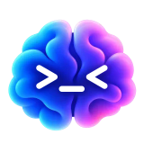
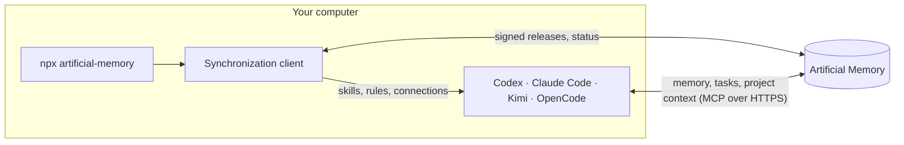

<p align="center">
  _<">
</p>

<h1 align="center">Artificial Memory</h1>

<p align="center">
  Project memory, tasks and rules for Codex, Claude Code, Kimi and OpenCode.<br>
  You, your teammates and your AI agents work in one space,<br>
  and a new chat starts where the last one ended.
</p>

<p align="center">
  <a href="https://www.npmjs.com/package/artificial-memory"></a>
  <a href="https://github.com/notbadov/artificial-memory/actions/workflows/tests.yml"></a>
  <a href="LICENSE"></a>
  
</p>

<p align="center">
  <a href="https://artificial-memory.com">Website</a> ·
  <a href="https://app.artificial-memory.com/cli">What the command does</a> ·
  <a href="docs/VERIFYING.md">Verify a download</a> ·
  <a href="README.ru.md">Русская версия</a>
</p>

<p align="center">
  
</p>

Artificial Memory is a service: https://artificial-memory.com. This repository holds the part
of it that runs on your computer, so that you can read what it does before you run it.

## Who it is for

People who work with AI coding apps and are tired of three things:

- every new chat starts from zero, and you explain again what was already decided and why;
- every computer has its own setup: one set of skills and connections on the laptop, another
  at work;
- an agent can do too much: deploy without asking, or write a guess into memory as a fact.

## Three steps to a first result

1. **Create an account** at https://artificial-memory.com. Your personal space appears with it.
2. **Connect a computer.** Either install the application for macOS and Windows from
   https://app.artificial-memory.com/download, or run one command in a terminal (Node.js 18 or
   newer, nothing else to install):

   ```
   npx artificial-memory connect
   ```

   The command shows a six-digit code and opens the browser; you confirm the code there.
   What the command checks, writes to disk and sends to the service is described step by step
   at https://app.artificial-memory.com/cli.
3. **Work as before.** Your AI apps read the memory of the project themselves and propose
   what to write into it; you approve what stays.

## How it works



- The launcher downloads a runtime signed with the release key and checks it before it runs
  anything.
- The client installs into your AI apps what your space approved: skills, rules and the
  connections to memory, tasks and project context. It changes only what it added itself.
- The apps then talk to the service directly. The client does not send your files, code or
  chats; what an agent proposes for memory waits for a person to approve it.

## Commands

| Command | What it does |
|---|---|
| `npx artificial-memory connect` | Connect this computer: a six-digit code, confirmed in the browser. |
| `npx artificial-memory status` | What is connected, the last synchronization, the background schedule. |
| `npx artificial-memory sync` | Synchronize now. |
| `npx artificial-memory consents` | Review skills with programs and servers that wait for your approval. |
| `npx artificial-memory schedule off` | Stop the hourly background synchronization (`on` starts it again). |
| `npx artificial-memory disconnect` | End the connection: access is revoked on the server and removed here. |
| `npx artificial-memory uninstall` | Disconnect and remove everything the client keeps on the computer. |

## What is in this repository

The code that runs on your computer:

| Path | What it is |
|---|---|
| `packages/command-line/` | The npm package `artificial-memory`: a launcher with no dependencies. It downloads the signed runtime, verifies it and starts the terminal client. |
| `adapters/client/` | The synchronization client and the terminal client. |
| `adapters/codex/`, `adapters/claude/`, `adapters/claude-desktop/`, `adapters/kimi/`, `adapters/opencode/` | What is installed into each AI app: skills, rules, hooks, modes and the connections to memory, tasks and project context. |
| `adapters/common/` | What the adapters share. |
| `tools/` | The installers of those connections, which the client starts, and the test runner. |
| `packages/python/agent-platform-core/` | The modules the installers import. |
| `tests/` | The tests of all of the above. They pass in this repository alone: [docs/TESTING.md](docs/TESTING.md). |

## What is not here

- **The service itself**: the servers that keep memory, tasks and project context, and the
  web application. A computer talks to them over HTTPS.
- **The desktop application.**
- **Skills and rules.** They are not part of this code. A computer receives them in a release
  signed with the release key and verifies the signature before anything is installed; the
  skills of your own space are written by you in the service. That is why some files here
  name a `shared/` directory that this repository does not have: it is a directory of a
  release.

This repository is a generated copy of the code we develop elsewhere: each publication is one
commit.

## Names you will see in the code

The code is older than the product's name, so a few internal names remain:

- **Agent Platform** is the earlier name of the client: hence `~/.agent-platform/`,
  `agent_platform_core` and the `AGENT_PLATFORM_*` variables.
- **Control Plane** is the part of the service that hands out releases and receives the status
  of each computer.
- **Desktop Companion** is the desktop application.
- `home-server-2026-09` is the id of the release signing key, the one in
  [docs/VERIFYING.md](docs/VERIFYING.md).

## Checking what you run

Everything the launcher downloads is signed, and the key is in this repository.
[docs/VERIFYING.md](docs/VERIFYING.md) shows what exactly is signed and how to check a
download by hand with `openssl` and Python.

## Questions, problems, security

- Questions and bug reports: [GitHub Issues](https://github.com/notbadov/artificial-memory/issues).
- A security problem: please report it privately, see [SECURITY.md](SECURITY.md).

## Licence

Apache License 2.0, see [LICENSE](LICENSE) and [NOTICE](NOTICE). The runtime the launcher
downloads contains software of other authors under their own licences:
[THIRD_PARTY_NOTICES.md](THIRD_PARTY_NOTICES.md).
