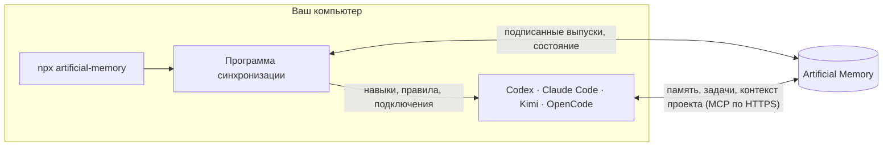

<p align="center">
  _<">
</p>

<h1 align="center">Artificial Memory</h1>

<p align="center">
  Память проекта, задачи и правила для Codex, Claude Code, Kimi и OpenCode.<br>
  Вы, ваши коллеги и ваши ИИ-агенты работаете в одном пространстве,<br>
  а новый чат начинается там, где закончился прошлый.
</p>

<p align="center">
  <a href="https://www.npmjs.com/package/artificial-memory"></a>
  <a href="https://github.com/notbadov/artificial-memory/actions/workflows/tests.yml"></a>
  <a href="LICENSE"></a>
  
</p>

<p align="center">
  <a href="https://artificial-memory.com">Сайт</a> ·
  <a href="https://app.artificial-memory.com/cli">Что делает команда</a> ·
  <a href="docs/VERIFYING.md">Проверка загрузки</a> ·
  <a href="README.md">English version</a>
</p>

<p align="center">
  
</p>

Artificial Memory — это сервис: https://artificial-memory.com. В этом репозитории лежит та его
часть, которая работает на вашем компьютере: её можно прочитать до того, как запускать.

## Для кого

Для тех, кто работает с ИИ-приложениями для программирования и устал от трёх вещей:

- каждый новый чат начинает с нуля, и вы снова объясняете агенту, что уже решили и почему;
- на каждом компьютере своя настройка: навыки и подключения на ноутбуке одни, на рабочем
  компьютере другие;
- агент может сделать лишнее: выкатить на рабочий сервер без спроса или записать в память
  догадку как факт.

## Три шага до первого результата

1. **Создайте аккаунт** на https://artificial-memory.com. Вместе с ним появится ваше личное
   пространство.
2. **Подключите компьютер.** Установите приложение для macOS и Windows со страницы
   https://app.artificial-memory.com/download или выполните одну команду в терминале (нужен
   Node.js 18 или новее, больше ничего ставить не надо):

   ```
   npx artificial-memory connect
   ```

   Команда покажет код из шести цифр и откроет браузер — подтвердите там этот код. Что команда
   проверяет, что пишет на диск и что отправляет на сервер, по шагам описано на странице
   https://app.artificial-memory.com/cli.
3. **Работайте как раньше.** ИИ-приложения сами читают память проекта и предлагают, что в неё
   записать; вы утверждаете, что останется.

## Как это устроено



- Программа запуска скачивает среду выполнения, подписанную ключом выпусков, и проверяет её до
  того, как что-либо запустить.
- Программа синхронизации устанавливает в ИИ-приложения то, что одобрено в вашем пространстве:
  навыки, правила и подключения к памяти, задачам и контексту проекта. Меняет она только то,
  что добавила сама.
- Дальше приложения работают с сервисом напрямую. Ваши файлы, код и переписку программа не
  отправляет; то, что агент предлагает записать в память, ждёт решения человека.

## Команды

| Команда | Что делает |
|---|---|
| `npx artificial-memory connect` | Подключить компьютер: код из шести цифр, подтверждение в браузере. |
| `npx artificial-memory status` | Что подключено, последняя синхронизация, фоновое расписание. |
| `npx artificial-memory sync` | Синхронизировать сейчас. |
| `npx artificial-memory consents` | Навыки с программами и серверы, которые ждут вашего разрешения. |
| `npx artificial-memory schedule off` | Остановить фоновую синхронизацию раз в час (`on` включает снова). |
| `npx artificial-memory disconnect` | Завершить подключение: доступ отзывается на сервере и убирается здесь. |
| `npx artificial-memory uninstall` | Отключить компьютер и удалить всё, что программа хранит на нём. |

## Что есть в этом репозитории

Код, который работает на вашем компьютере:

| Путь | Что это |
|---|---|
| `packages/command-line/` | npm-пакет `artificial-memory`: программа запуска без зависимостей. Она скачивает подписанную среду выполнения, проверяет её и запускает команду. |
| `adapters/client/` | Программа синхронизации и команда для терминала. |
| `adapters/codex/`, `adapters/claude/`, `adapters/claude-desktop/`, `adapters/kimi/`, `adapters/opencode/` | То, что устанавливается в каждое ИИ-приложение: навыки, правила, хуки, режимы и подключения к памяти, задачам и контексту проекта. |
| `adapters/common/` | Общее для всех адаптеров. |
| `tools/` | Установщики этих подключений, которые запускает программа синхронизации, и запуск тестов. |
| `packages/python/agent-platform-core/` | Модули, которые нужны установщикам. |
| `tests/` | Тесты всего перечисленного. Они проходят в одном этом репозитории: [docs/TESTING.md](docs/TESTING.md) (на английском). |

## Чего здесь нет

- **Самого сервиса**: серверов, которые хранят память, задачи и контекст проекта, и
  веб-приложения. Компьютер обращается к ним по HTTPS.
- **Приложения для компьютера.**
- **Навыков и правил.** Они не входят в этот код. Компьютер получает их в выпуске, подписанном
  ключом выпусков, и проверяет подпись до установки; навыки своего пространства вы пишете в
  самом сервисе. Поэтому в некоторых файлах упоминается папка `shared/`, которой здесь нет:
  это папка выпуска.

Этот репозиторий — сгенерированная копия кода, который мы разрабатываем в другом месте: каждая
публикация — один коммит.

## Какие названия встретятся в коде

Код старше названия продукта, поэтому в нём остались внутренние имена:

- **Agent Platform** — прежнее название программы: отсюда `~/.agent-platform/`,
  `agent_platform_core` и переменные `AGENT_PLATFORM_*`.
- **Control Plane** — часть сервиса, которая раздаёт выпуски и принимает состояние каждого
  компьютера.
- **Desktop Companion** — приложение для компьютера.
- `home-server-2026-09` — идентификатор ключа подписи выпусков, того самого, что в
  [docs/VERIFYING.md](docs/VERIFYING.md).

## Как проверить то, что вы запускаете

Всё, что скачивает программа запуска, подписано, а ключ лежит в этом репозитории. В
[docs/VERIFYING.md](docs/VERIFYING.md) (на английском) показано, что именно подписано и как
проверить загрузку вручную с помощью `openssl` и Python.

## Вопросы, ошибки, безопасность

- Вопросы и сообщения об ошибках: [GitHub Issues](https://github.com/notbadov/artificial-memory/issues).
- О проблеме безопасности сообщите, пожалуйста, не публично: см. [SECURITY.md](SECURITY.md).

## Лицензия

Apache License 2.0: см. [LICENSE](LICENSE) и [NOTICE](NOTICE). Среда выполнения, которую
скачивает программа запуска, содержит программы других авторов под их собственными лицензиями:
[THIRD_PARTY_NOTICES.md](THIRD_PARTY_NOTICES.md).
